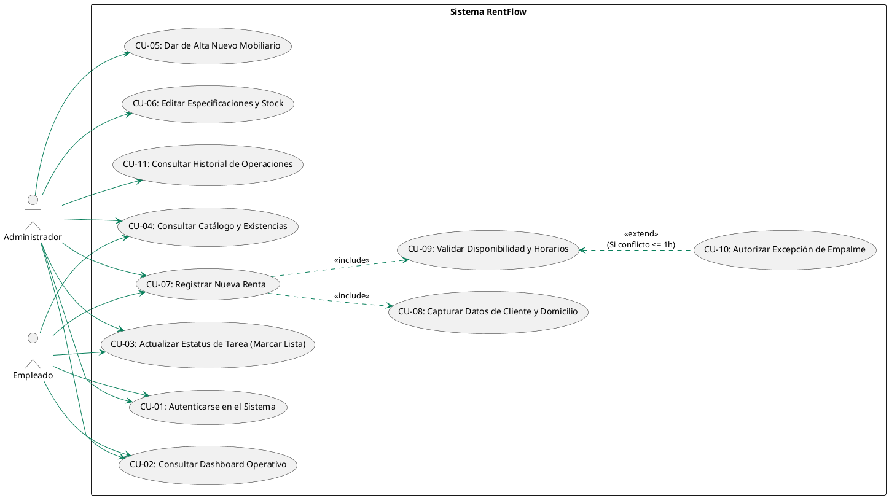
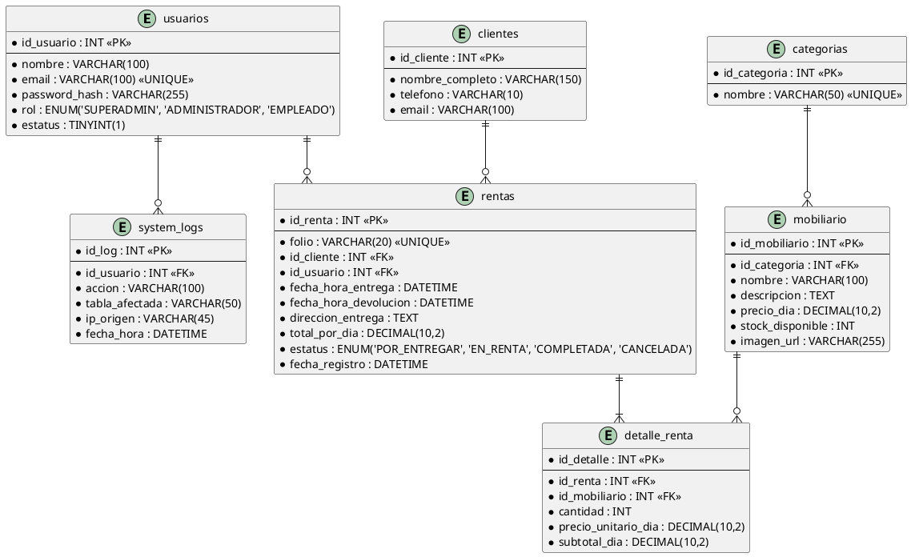
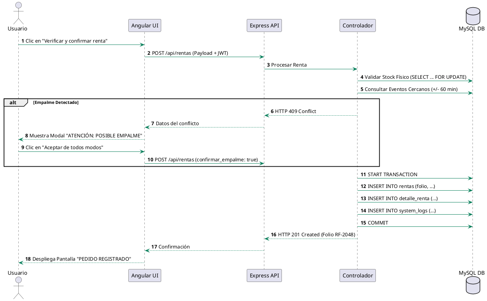

# RentFlow Systems - Documentación Técnica y Arquitectura de Software

**Universidad Tecnológica de Torreón**

**Dirección de la Carrera de Ingeniería en Desarrollo y Gestión de Software**

**Asignatura:** Desarrollo Web Profesional

**Docente:** Ing. Jesús Del Toro Robledo

**Grado y Sección:** 8.º Cuatrimestre — Sección "A"

**Fecha de Publicación:** Octubre de 2026 — Torreón, Coahuila, México

---

## Equipo de Desarrollo y Roles del Proyecto

* **Melany Elena de los Angeles Landeros Fernández** — Líder de Proyecto y Arquitecta de Software (*Project Lead & Software Architect*)
* **Diego Cassio** — Desarrollador Frontend (*Angular Specialist*)
* **Gabriel** — Desarrollador Backend (*Node.js & Express Specialist*)
* **Javier Saucedo** — Administrador de Base de Datos (*MySQL Specialist*)

---

## CAPÍTULO I. RESUMEN EJECUTIVO Y FICHA TÉCNICA

RentFlow Systems es una solución web integral diseñada para la administración centralizada de inventarios, el control logístico de entregas y recolecciones en tiempo real, y el registro de contratos de arrendamiento de mobiliario para eventos sociales y corporativos. El sistema resuelve el problema del sobrecompromiso de inventario (overbooking) mediante un algoritmo de validación de disponibilidad por bloques de tiempo y detección preventiva de empalmes logísticos en márgenes iguales o inferiores a 60 minutos.

### Ficha Técnica de Infraestructura

| Componente | Tecnología Seleccionada | Versión / Especificación |
| --- | --- | --- |
| **Arquitectura** | Desacoplada cliente-servidor (RESTful API) | Single Page Application (SPA) + Stateless API |
| **Frontend Framework** | Angular | 17+ (TypeScript, ReactiveForms, RxJS) |
| **Backend Framework** | Node.js / Express.js | Event-driven, I/O No Bloqueante |
| **Base de Datos** | MySQL Server | 8.0+ (Motor InnoDB, Transacciones ACID) |
| **Seguridad & Auth** | JSON Web Tokens (JWT) + Bcrypt | Costo de salado 10, Auth stateless, RBAC |
| **Diseño / UI** | Tailwind CSS | Breakpoints adaptativos, CSS3 / HTML5 |
| **Gestión de Procesos** | PM2 | Monitorización 24/7 y reinicio automático |

---

## CAPÍTULO II. PROBLEMÁTICA Y JUSTIFICACIÓN DEL PROYECTO

### 2.1 Planteamiento y Contextualización

Los pequeños negocios dedicados al arrendamiento de mobiliario administran existencias, clientes, reservaciones y logística de forma fragmentada. Los registros manuales en papel u hojas de cálculo sin validación concurrente generan las siguientes deficiencias operativas:

1. **Incapacidad de cálculo por intervalos horarios:** La evaluación por día completo inhabilita el reúso de mobiliario devuelto temprano para eventos vespertinos o nocturnos.
2. **Traslape de reservaciones (Overbooking):** La falta de un motor transaccional permite confirmar pedidos que superan la capacidad física real del almacén durante ventanas de coincidencia horaria.
3. **Complejidad logística y falta de trazabilidad:** La información dispersa impide auditar qué usuario registró o modificó una orden y dificulta la planeación diaria de rutas de transporte.

### 2.2 Justificación Multifactorial

* **Justificación Teórica:** Aplica principios de ingeniería de software sobre evaluación de intervalos de tiempo, control de acceso basado en roles (RBAC), arquitectura N-Capas y gestión de transacciones concurrentes pesimistas.
* **Justificación Práctica y Operativa:** Centraliza la operación diaria reduciendo errores humanos en mostrador y campo, permitiendo a Administradores y Empleados trabajar sobre un único flujo validado.
* **Justificación Metodológica y Tecnológica:** La combinación de Angular, Node.js, Express y MySQL garantiza una arquitectura extensible, responsiva y altamente mantenible.

---

## CAPÍTULO III. OBJETIVOS, ALCANCE, LIMITACIONES Y MVP

### 3.1 Objetivos

#### 3.1.1 Objetivo General

Desarrollar e implementar RentFlow Systems, un sistema web para la gestión de pequeños negocios dedicados al arrendamiento de mobiliario para eventos, utilizando Angular, Node.js, Express y MySQL, que centralice la información de clientes, inventario y rentas, valide la disponibilidad de artículos por fechas y horarios solicitados, y organice la operación logística mediante controles de seguridad.

#### 3.1.2 Objetivos Específicos

* Diseñar e implementar una base de datos relacional normalizada en 3FN en MySQL con soporte transaccional InnoDB.
* Desarrollar una API RESTful stateless en Node.js/Express con validación estricta de entrada y manejo centralizado de errores.
* Construir una interfaz SPA responsiva en Angular 17+ adaptada a dispositivos móviles, tabletas y computadoras.
* Implementar el algoritmo de validación de disponibilidad horaria y prevención de empalmes.
* Configurar mecanismos de seguridad mediante JWT, hashing Bcrypt y control de acceso por roles (RBAC).
* Proporcionar un panel de control operativo para la gestión diaria de entregas y recolecciones.

### 3.2 Alcances del Proyecto

Comprende el análisis, diseño, desarrollo, integración y prueba de una versión funcional que incluye:

* Módulo de Autenticación y Seguridad (RBAC).
* Módulo de Gestión de Clientes.
* Módulo de Catálogo e Inventario Central.
* Módulo de Gestión de Rentas y Motor de Disponibilidad.
* Panel de Control Operativo (Dashboard Logístico).
* Módulo de Auditoría de Sistema (System Logs Inmutables).

### 3.3 Limitaciones

* Sin integración fiscal CFDI/SAT.
* Sin procesamiento de pagos con pasarelas en línea (cobro gestionado fuera de sistema).
* Dependencia de conexión a red (sin funcionamiento offline en v1.0).
* Sin aplicaciones móviles nativas (acceso vía navegador web responsivo).

### 3.4 Producto Mínimo Viable (MVP)

El MVP integra: autenticación con roles, registro de clientes, catálogo de mobiliario con existencias, captura de rentas con validación transaccional de disponibilidad en servidor, panel de tareas diarias y validaciones de seguridad básicas.

---

## CAPÍTULO IV. REQUISITOS DEL SISTEMA Y LÓGICA DE NEGOCIO

### 4.1 Requisitos Funcionales (RF)

* **RF-01 (Autenticación de Usuarios):** Credenciales de acceso mediante correo y contraseña con generación de JWT.
* **RF-02 (Control de Acceso RBAC):** Restricción de endpoints y vistas según los roles Super Administrador, Administrador y Empleado.
* **RF-03 (Gestión de Clientes):** Registro, edición y consulta de datos de contacto de clientes.
* **RF-04 (Gestión de Catálogo e Inventario):** Administración de artículos, categorías, precios por día y stock físico total.
* **RF-05 (Registro de Rentas):** Captura de contratos asociando cliente, fechas, horarios, dirección y artículos.
* **RF-06 (Validación de Intervalos):** Comprobación obligatoria de que `Hora_Fin > Hora_Inicio` y vigencia máxima a 60 días.
* **RF-07 (Validación de Disponibilidad):** Cálculo automático de stock comprometido en bloques horarios coincidentes.
* **RF-08 (Control de Concurrencia):** Manejo de solicitudes simultáneas en MySQL mediante bloqueos pesimistas (`SELECT ... FOR UPDATE`).
* **RF-09 (Panel Operativo Logístico):** Dashboard dinámico para marcar tareas completadas de entregas y recolecciones.
* **RF-10 (Historial y Auditoría):** Bitácora inmutable de eventos con registro de usuario, acción, estampa de tiempo e IP.

### 4.2 Requisitos No Funcionales (RNF)

* **RNF-01 (Seguridad de Credenciales):** Hashing de contraseñas mediante Bcrypt con costo de salado 10.
* **RNF-02 (Validación de Entradas):** Sanitización en backend con `express-validator` y `xss-clean`.
* **RNF-03 (Protección SQLi):** Uso exclusivo de consultas preparadas (Prepared Statements).
* **RNF-04 (Integridad Transaccional):** Cumplimiento ACID estricto utilizando el motor InnoDB.
* **RNF-05 (Arquitectura Desacoplada):** Comunicación exclusiva vía HTTP/HTTPS y datos en formato JSON.
* **RNF-06 (Diseño Responsivo):** Adaptabilidad completa mediante breakpoints de Tailwind CSS.
* **RNF-07 (Gestión de Errores):** Respuestas sanitizadas que previenen la fuga de información sensible.
* **RNF-08 (Rendimiento):** Tiempo de respuesta de consultas de disponibilidad inferior a 400 ms.
* **RNF-09 (Control de Sesión):** Expiración automática de tokens JWT a las 8 horas.
* **RNF-10 (Mantenibilidad):** Estructura modular N-Capas organizada bajo Git con ramas de desarrollo.

### 4.3 Historias de Usuario Destacadas

| ID | Rol | Historia de Usuario | Criterio de Aceptación |
| --- | --- | --- | --- |
| **HU-01** | Empleado | Consultar disponibilidad horaria de artículos para una fecha y rango de horas. | El sistema muestra solo los artículos con stock real suficiente para ese bloque exacto. |
| **HU-02** | Administrador | Gestionar el catálogo de artículos, stock total y precios de renta por día. | Cambios reflejados al instante en el módulo de rentas. |
| **HU-03** | Empleado | Registrar datos de cliente y asociarlos a un contrato de renta. | Teléfono validado a 10 dígitos y dirección completa obligatoria. |
| **HU-04** | Administrador | Consultar la agenda de entregas y recolecciones del día y la semana. | Clasificación clara entre salidas (azul) y retornos (morado). |
| **HU-05** | Super Admin | Revisar la bitácora de auditoría inmutable de transacciones. | Muestra usuario, fecha, tabla, acción e IP sin permitir edición o borrado. |
| **HU-06** | Todos | Recibir alertas claras en caso de indisponibilidad o conflicto de horarios. | Modal de advertencia detallando el motivo y la acción correctiva. |

---

## CAPÍTULO V. ANÁLISIS Y MATRIZ DE RIESGOS

El proyecto evalúa 15 riesgos críticos ponderados por Probabilidad (P: 1-5) e Impacto (I: 1-5), determinando el Nivel (N = P × I).

| ID | Riesgo | P | I | Nivel | Consecuencia | Estrategia de Mitigación / Solución |
| --- | --- | --- | --- | --- | --- | --- |
| **R1** | Salida de integrante del equipo | 3 | 5 | **15** | Retraso y sobrecarga de trabajo | Documentación compartida, WBS y representante designado (Javier). |
| **R2** | Reservas simultáneas (Overbooking) | 3 | 5 | **15** | Compromiso de inventario inexistente | Transacciones pesimistas (`SELECT ... FOR UPDATE`) en MySQL InnoDB. |
| **R3** | Caída del servidor Node.js (Crash) | 2 | 4 | **8** | Interrupción del servicio web | Gestor de procesos PM2 con reinicio automático y logs de error. |
| **R4** | Vulnerabilidad o robo de JWT | 2 | 5 | **10** | Acceso no autorizado | Expiración de token a 8h, almacenamiento en sessionStorage y RBAC. |
| **R5** | Pérdida de conectividad a BD | 4 | 3 | **12** | Imposibilidad de registrar rentas | Manejo de reconexión en pool MySQL y alertas claras en interfaz. |
| **R6** | Errores por zona horaria en fechas | 3 | 4 | **12** | Cálculos de disponibilidad erróneos | Normalización de estampas de tiempo en formato Estándar UTC/ISO. |
| **R7** | Bloqueos de integración por CORS | 4 | 2 | **8** | Errores de comunicación HTTP | Configuración explícita del middleware `cors` en Express para orígenes autorizados. |
| **R8** | Pérdida o corrupción de la base de datos | 1 | 5 | **5** | Pérdida crítica de información | Scripts DDL en repositorio y respaldos periódicos con `mysqldump`. |
| **R9** | Degradación de velocidad en consultas | 4 | 3 | **12** | Lentitud en el flujo de checkout | Índices compuestos en columnas `nombre`, `categoria` y `fechas`. |
| **R10** | Captura de datos malformados | 3 | 3 | **9** | Registros inconsistentes | Validación dual: RegEx en Angular ReactiveForms y `express-validator` en backend. |
| **R11** | Saturación de disco por logs | 2 | 2 | **4** | Afectación del almacenamiento | Rotación de archivos de logs y depuración periódica de datos temporales. |
| **R12** | Deficiencias de diseño en móviles | 3 | 3 | **9** | Dificultad operativa en campo | Maquetación Mobile-First utilizando clases responsivas de Tailwind CSS. |
| **R13** | Regresión funcional en actualizaciones | 3 | 4 | **12** | Fallos en componentes validados | Flujo de trabajo Git por ramas y pruebas de integración antes de merges. |
| **R14** | Incompatibilidad de JSON Front/Back | 3 | 3 | **9** | Errores de mapeo de datos | Definición estricta de DTOs y contratos de interfaz en TypeScript. |
| **R15** | Distribución desigual de carga de trabajo | 2 | 4 | **8** | Cuellos de botella en entregables | Seguimiento semanal en tablero Scrum y reasignación ágil de tareas. |

---

## CAPÍTULO VI. METODOLOGÍA, ROLES Y ESTRATEGIA DE CONTROL DE VERSIONES

### 6.1 Metodología Scrum Adaptada

El proyecto se ejecuta en iteraciones (Sprints) de 2 semanas, garantizando la integración continua de la interfaz SPA con la API RESTful.

### 6.2 Estrategia de Control de Versiones y Flujo de Ramas (Git Branching Model)

Para garantizar la estabilidad del código base y la integridad de las entregas, el equipo aplica un flujo de trabajo estructurado por ramas (Feature Branch Workflow) bajo la administración directa de **Melany Landeros** (Líder de Proyecto y Arquitecta de Software):

* **Rama `main` (Producción):** Rama protegida que contiene código estable y listo para despliegue.
* **Rama `develop` (Integración):** Rama central donde se consolidan las funcionalidades de cada hito tras superar pruebas de integración.
* **Ramas `feature/*` (Desarrollo Individual):** Ramas de trabajo aisladas asignadas por rol y módulo:
* `feature/frontend-*` (Diego Cassio - Vistas, Formularios y Estilos)
* `feature/backend-*` (Gabriel - API, Middlewares y Algoritmo)
* `feature/database-*` (Javier Saucedo - Scripts DDL, Procedimientos y Transacciones)


* **Gestión de Pull Requests (PRs) y Code Review:** La Líder de Proyecto es la única integrante autorizada para auditar el código, resolver conflictos y ejecutar los *Merges* hacia `develop` y `main`, garantizando que ninguna actualización rompa módulos previamente validados.

### 6.3 Estructura de Desglose de Trabajo (WBS)

| ID | Tarea / Descripción | Responsable | Esfuerzo | Criterio de Aceptación |
| --- | --- | --- | --- | --- |
| **T-01** | Documentación de Arquitectura y Rúbrica | Melany | 15 HH | Requisitos, WBS, diagramas y cronograma aprobados. |
| **T-02** | Diseño DDL de BD MySQL e índices | Javier | 12 HH | Script SQL ejecutable en 3FN con transacciones y tablas log. |
| **T-03** | Configuración inicial de API REST Express | Gabriel | 8 HH | Servidor Node conectado a MySQL con manejo de errores. |
| **T-04** | Setup de Angular 17+ y ruteo base | Diego | 10 HH | Estructura SPA con módulos, componentes y guards. |
| **T-05** | Autenticación JWT y Middlewares RBAC | Gabriel | 14 HH | Inicio de sesión funcional y protección de rutas. |
| **T-06** | Módulos CRUD de Clientes e Inventario | Gabriel / Diego / Javier | 22 HH | Operaciones de catálogo y clientes validadas. |
| **T-07** | Motor de Disponibilidad y Concurrencia | Gabriel / Javier | 24 HH | Algoritmo anti-empalme con bloqueos `SELECT ... FOR UPDATE`. |
| **T-08** | Formularios Reactivos y Vistas SPA | Diego / Melany | 22 HH | Interfaz responsiva con validaciones RegEx y feedback. |
| **T-09** | Dashboard Operativo de Tareas | Diego / Gabriel | 12 HH | Tablero diario con actualización en 1 clic. |
| **T-10** | Integración y Pruebas E2E / Seguridad | Todo el equipo | 20 HH | Pruebas de estrés y flujo de checkout superados. |
| **T-11** | QA, corrección de bugs y liberación | Melany / Todo el equipo | 16 HH | Sistema estabilizado y desplegado para producción. |

### 6.4 Cronograma e Hitos Verificables

| Hito / Actividad | Responsable | Fecha Inicio | Fecha Fin | Entregable Clave |
| --- | --- | --- | --- | --- |
| **Hito 1:** Documentación Técnica Inicial | Melany | 05/Oct/2026 | 13/Oct/2026 | Documento de Arquitectura y Rúbrica entregado. |
| **Hito 2:** Diseño DDL y Maquetación Base | Javier / Diego | 14/Oct/2026 | 29/Oct/2026 | Script MySQL e interfaces de UI prototipadas. |
| **Hito 3:** Núcleo Lógico, Auth y Backend | Gabriel | 30/Oct/2026 | 15/Nov/2026 | API REST, JWT y motor de disponibilidad funcional. |
| **Hito 4:** Integración SPA y Dashboard | Melany / Diego | 16/Nov/2026 | 30/Nov/2026 | Frontend consumiendo API con formularios reactivos. |
| **Hito 5:** Pruebas E2E y Liberación Final | Todo el equipo | 01/Dic/2026 | 10/Dic/2026 | Sistema probado y entregado (Deadline Oficial). |

---

## CAPÍTULO VII. ARQUITECTURA, PATRONES Y DIAGRAMAS UML

### 7.1 Patrones de Diseño Implementados

#### Patrones Creacionales

* **Singleton:** Aplicado en la gestión del Pool de Conexiones a MySQL (`database.js`) para evitar el agotamiento de puertos socket.
* **Factory Method:** Implementado en `HttpResponseFactory` para estandarizar las respuestas JSON de la API.

#### Patrones Estructurales

* **Facade:** Encapsulado en `RentaService` para coordinar la verificación de cliente, validación de stock, transacciones SQL y registro de logs en una sola invocación (`crearRenta()`).
* **Decorator:** Utilizado en la tubería de middlewares de Express (Helmet, Auth JWT, RBAC) y en el `AuthInterceptor` de Angular.
* **Adapter:** Implementado en `DateAdapter` para normalizar fechas entre Angular y MySQL en formato UTC.

#### Patrones de Comportamiento

* **Strategy:** Utilizado en `DisponibilidadStrategy` para intercambiar algoritmos de cálculo de inventario según el contexto operativo.
* **Observer:** Implementado mediante RxJS (`BehaviorSubject`) en Angular para la reactividad de la interfaz.
* **Chain of Responsibility:** Aplicado en el flujo de ejecución de middlewares en Express.js.

### 7.2 Diagrama de Casos de Uso (UML)



### 7.3 Diagrama Entidad-Relación (DER - Modelo Relacional 3FN)



### 7.4 Diagrama de Secuencia (Validación y Checkout)



---

## CAPÍTULO VIII. DICCIONARIO DE DATOS COMPLETO

### 1. Tabla: `usuarios`

| Campo | Tipo de Dato | Llave | Restricciones | Descripción |
| --- | --- | --- | --- | --- |
| `id_usuario` | `INT` | **PK** | `AUTO_INCREMENT`, `NOT NULL` | Identificador único del usuario. |
| `nombre` | `VARCHAR(100)` | — | `NOT NULL` | Nombre completo del usuario. |
| `email` | `VARCHAR(100)` | — | `UNIQUE`, `NOT NULL` | Correo electrónico de acceso. |
| `password_hash` | `VARCHAR(255)` | — | `NOT NULL` | Hash cifrado con Bcrypt. |
| `rol` | `ENUM('SUPERADMIN','ADMINISTRADOR','EMPLEADO')` | — | `NOT NULL` | Rol y privilegios del usuario. |
| `estatus` | `TINYINT(1)` | — | `NOT NULL`, `DEFAULT 1` | Estado de la cuenta (`1` = Activa, `0` = Inactiva). |

### 2. Tabla: `categorias`

| Campo | Tipo de Dato | Llave | Restricciones | Descripción |
| --- | --- | --- | --- | --- |
| `id_categoria` | `INT` | **PK** | `AUTO_INCREMENT`, `NOT NULL` | Identificador único de la categoría. |
| `nombre` | `VARCHAR(50)` | — | `UNIQUE`, `NOT NULL` | Nombre de la categoría (*Sillas, Mesas, Toldos*, etc.). |

### 3. Tabla: `mobiliario`

| Campo | Tipo de Dato | Llave | Restricciones | Descripción |
| --- | --- | --- | --- | --- |
| `id_mobiliario` | `INT` | **PK** | `AUTO_INCREMENT`, `NOT NULL` | Identificador del producto. |
| `id_categoria` | `INT` | **FK** | `NOT NULL` | Referencia a `categorias(id_categoria)`. |
| `nombre` | `VARCHAR(100)` | — | `NOT NULL` | Nombre comercial del artículo. |
| `descripcion` | `TEXT` | — | `NULL` | Especificaciones técnicas y dimensiones. |
| `precio_dia` | `DECIMAL(10,2)` | — | `NOT NULL`, `CHECK (precio_dia > 0)` | Tarifa de arrendamiento diaria. |
| `stock_disponible` | `INT` | — | `NOT NULL`, `CHECK (stock_disponible >= 0)` | Cantidad física total en almacén. |
| `imagen_url` | `VARCHAR(255)` | — | `NULL` | Ruta del archivo de imagen (formatos WebP/PNG). |

### 4. Tabla: `clientes`

| Campo | Tipo de Dato | Llave | Restricciones | Descripción |
| --- | --- | --- | --- | --- |
| `id_cliente` | `INT` | **PK** | `AUTO_INCREMENT`, `NOT NULL` | Identificador del cliente. |
| `nombre_completo` | `VARCHAR(150)` | — | `NOT NULL` | Nombre o razón social del titular. |
| `telefono` | `VARCHAR(10)` | — | `NOT NULL` | Teléfono de contacto a 10 dígitos. |
| `email` | `VARCHAR(100)` | — | `NULL` | Correo electrónico opcional. |

### 5. Tabla: `rentas`

| Campo | Tipo de Dato | Llave | Restricciones | Descripción |
| --- | --- | --- | --- | --- |
| `id_renta` | `INT` | **PK** | `AUTO_INCREMENT`, `NOT NULL` | Identificador interno del contrato. |
| `folio` | `VARCHAR(20)` | — | `UNIQUE`, `NOT NULL` | Clave alfanumérica única (ej. `RF-2048`). |
| `id_cliente` | `INT` | **FK** | `NOT NULL` | Referencia a `clientes(id_cliente)`. |
| `id_usuario` | `INT` | **FK** | `NOT NULL` | Referencia a `usuarios(id_usuario)`. |
| `fecha_hora_entrega` | `DATETIME` | — | `NOT NULL` | Estampa temporal de entrega programada. |
| `fecha_hora_devolucion` | `DATETIME` | — | `NOT NULL` | Estampa temporal de recolección programada. |
| `direccion_entrega` | `TEXT` | — | `NOT NULL` | Domicilio completo de la locación. |
| `total_por_dia` | `DECIMAL(10,2)` | — | `NOT NULL` | Importe total diario acumulado. |
| `estatus` | `ENUM('POR_ENTREGAR','EN_RENTA','COMPLETADA','CANCELADA')` | — | `NOT NULL`, `DEFAULT 'POR_ENTREGAR'` | Estatus del ciclo logístico. |
| `fecha_registro` | `DATETIME` | — | `NOT NULL`, `DEFAULT CURRENT_TIMESTAMP` | Estampa de auditoría de creación. |

### 6. Tabla: `detalle_renta`

| Campo | Tipo de Dato | Llave | Restricciones | Descripción |
| --- | --- | --- | --- | --- |
| `id_detalle` | `INT` | **PK** | `AUTO_INCREMENT`, `NOT NULL` | Identificador del renglón de desglose. |
| `id_renta` | `INT` | **FK** | `NOT NULL`, `ON DELETE CASCADE` | Referencia a `rentas(id_renta)`. |
| `id_mobiliario` | `INT` | **FK** | `NOT NULL` | Referencia a `mobiliario(id_mobiliario)`. |
| `cantidad` | `INT` | — | `NOT NULL`, `CHECK (cantidad > 0)` | Piezas reservadas de este ítem. |
| `precio_unitario_dia` | `DECIMAL(10,2)` | — | `NOT NULL` | Fotografía histórica de la tarifa diaria. |
| `subtotal_dia` | `DECIMAL(10,2)` | — | `NOT NULL` | Resultado de `cantidad` * `precio_unitario_dia`. |

### 7. Tabla: `system_logs`

| Campo | Tipo de Dato | Llave | Restricciones | Descripción |
| --- | --- | --- | --- | --- |
| `id_log` | `INT` | **PK** | `AUTO_INCREMENT`, `NOT NULL` | Identificador del evento de auditoría. |
| `id_usuario` | `INT` | **FK** | `NOT NULL` | Referencia a `usuarios(id_usuario)`. |
| `accion` | `VARCHAR(100)` | — | `NOT NULL` | Acción realizada (`CREAR_RENTA`, `LOGIN`, etc.). |
| `tabla_afectada` | `VARCHAR(50)` | — | `NOT NULL` | Entidad modificada en el sistema. |
| `ip_origen` | `VARCHAR(45)` | — | `NOT NULL` | Dirección IP del cliente que ejecutó la orden. |
| `fecha_hora` | `DATETIME` | — | `NOT NULL`, `DEFAULT CURRENT_TIMESTAMP` | Fecha y hora exacta del registro inmutable. |

---

## CAPÍTULO IX. ESTRUCTURA DE PANTALLAS Y NAVEGACIÓN UI/UX

### 9.1 Árbol de Rutas Angular SPA

* `/login`: Autenticación de usuarios e inicio de sesión.
* `/dashboard`: Tablero operativo con entregas y recolecciones del día y agenda semanal.
* `/rentas/nueva`: Flujo guiado de selección de mobiliario, captura de cliente y checkout.
* `/rentas/historial`: Consulta de contratos pasados y activos (Rol Admin / Super Admin).
* `/catalogo`: Administración de inventario, existencias físicas y altas (Rol Admin / Super Admin).
* `/admin/logs`: Bitácora inmutable de auditoría del sistema (Exclusivo Super Admin).

### 9.2 Descripción Estructurada de Vistas

#### 1. Inicio de Sesión (`/login`)

Diseño minimalista con área segura (Safe Area). Contiene campo de correo, contraseña y botón de ingreso. Sin opciones públicas de registro de usuario por ser de uso operativo interno exclusivo.

#### 2. Tablero Operativo (`/dashboard`)

Presenta el saludo al usuario, métricas diarias (entregas, recolecciones, completadas), columnas pareadas de tareas con botón `✓ Marcar lista` en 1 clic y carrusel inferior de la agenda semanal.

#### 3. Selección de Mobiliario (`/rentas/nueva`)

Buscador predictivo e insensible a acentos/mayúsculas. Categorías en píldoras (*Sillas, Mesas, Toldos, Salas Lounge*), cuadrícula de productos con insignias de stock en verde y barra flotante inferior con total diario acumulado.

#### 4. Formulario de Pedido (Checkout)

Dividido en dos bloques secuenciales: Paso 1 (Fechas y Horas obligatorias) y Paso 2 (Datos del Cliente: Nombre, Teléfono a 10 dígitos y Dirección). Incluye panel lateral de resumen con Stepper de reajuste.

#### 5. Modal de Alerta de Empalme Logístico

Ventana emergente en color naranja que se activa si detecta un evento a $\le 60$ minutos de diferencia. Muestra el evento previo conflictivo y ofrece las opciones `Cancelar / Modificar` o `Aceptar de todos modos`.

#### 6. Confirmación de Pedido Creado

Pantalla de cierre con icono de verificación verde, mensaje de éxito, folio único asignado (ej. `RF-2048`) y botón `Volver al inicio` que limpia la memoria temporal del carrito.

#### 7. Auditoría y Logs (`/admin/logs`)

Tabla exclusiva para Super Administrador que muestra el historial inmutable de acciones, usuario responsable, tabla afectada, IP y fecha/hora, sin opciones de modificación o borrado.

---

## CAPÍTULO X. ESTRATEGIA DE DOBLE VALIDACIÓN (DEFENSE IN DEPTH)

| Tipo de Validación | Capa Frontend (Angular 17+) | Capa Backend (Node.js / Express / MySQL) |
| --- | --- | --- |
| **Campos Obligatorios** | `Validators.required`, inhabilitación de botones. | Verificación de payload e inspección con `express-validator`. |
| **Teléfono (10 dígitos)** | `Validators.pattern('^[0-9]{10}$')`. | Expresión regular en middleware previo a la base de datos. |
| **Correo Electrónico** | Validador de patrón RFC 5322 en ReactiveForms. | Sanitización y validación `.isEmail()`. |
| **Rango de Fechas** | Selector visual limitado a `Fecha_Actual + 60 días`. | Cálculo de diferencia en días; rechazo HTTP 400 si excede 60 días. |
| **Coherencia Horaria** | Validación interactiva `Hora_Fin > Hora_Inicio`. | Comprobación matemática en servidor; rechazo HTTP 400. |
| **Stock y Overbooking** | Peticiones asíncronas `GET /api/disponibilidad`. | Transacción pesimista `SELECT ... FOR UPDATE` en MySQL InnoDB. |
| **Seguridad y SQLi** | Escapado automático en plantillas de Angular. | Consultas preparadas (Prepared Statements) y sanitización XSS. |

---

## CAPÍTULO XI. INVENTARIO DE CONTENIDO Y LICENCIAS

* **Textos y Copywriting:** Español neutro estándar, tono profesional, neutro y orientado a la acción ("Registrar Renta", "Verificar y confirmar renta").
* **Recursos Gráficos:** Fotografía de mobiliario en formato WebP con peso inferior a 100 KB para optimización móvil (RNF-01). Iconografía vectorial Heroicons / Lucide Icons bajo licencia MIT / CC0.
* **Tipografía Web:** Familia Inter / Roboto vía Google Fonts bajo licencia SIL Open Font License (OFL v1.1).
* **Licencias de Software:** Angular, Node.js, Express, Tailwind CSS, Bcrypt y JWT bajo Licencia MIT. MySQL Server bajo Licencia GPL v2 / Comercial.

---

## CAPÍTULO XII. GUÍA DE INSTALACIÓN Y DESPLIEGUE LOCAL

### Prerrequisitos

* Node.js v18.0 o superior
* MySQL Server 8.0 o superior
* Angular CLI v16.0 o superior

### Pasos de Configuración

1. **Clonar el Repositorio:**
```bash
git clone https://github.com/tu-usuario/rentflow-system.git
cd rentflow-system

```


2. **Configurar la Base de Datos:**
* Importa el esquema SQL ubicado en `database/schema.sql` en tu instancia de MySQL.
* Ajusta las credenciales de conexión en el archivo `backend/config/db.js`.


3. **Despliegue del Backend (API REST):**
```bash
cd backend
npm install
npm start

```


4. **Despliegue del Frontend (Angular SPA):**
```bash
cd frontend
npm install
ng serve

```


Abre tu navegador e ingresa a `http://localhost:4200.

`http://localhost:4200`.

---

## CAPÍTULO XIII. CONTACTO Y LICENCIA DE USO

### Equipo de Desarrollo — Universidad Tecnológica de Torreón

* **Líder de Proyecto & Arquitecta de Software:** Melany Elena de los Angeles Landeros Fernández
* **Desarrollador Frontend:** Diego Cassio
* **Desarrollador Backend:** Gabriel
* **Administrador de Base de Datos:** Javier Saucedo

### Licencia del Proyecto

Este proyecto de software se distribuye bajo la **Licencia MIT**. Todos los derechos sobre la marca, arquitectura y diseño de interfaz de **RentFlow Systems** quedan reservados para el equipo de desarrollo de la Universidad Tecnológica de Torreón (2026).
